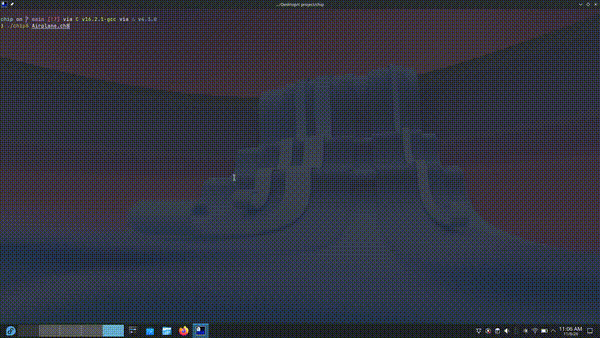

# Chip 8 emulator

It is a cli based Chip 8 Emulator. Just pass the file path and get it working



# Features

- Supports all machine codes of base chip-8 emulator
- easy to use

## Requirements

a C compiler, CMake ≥ 3.14, git, and raylib's system dependencies
(raylib itself is downloaded and built automatically).

Fedora:

```
sudo dnf install gcc cmake git mesa-libGL-devel libX11-devel libXrandr-devel \
  libXi-devel libXcursor-devel libXinerama-devel alsa-lib-devel
```

Debian/Ubuntu:

```
sudo apt install build-essential cmake git libgl1-mesa-dev libx11-dev \
  libxrandr-dev libxi-dev libxcursor-dev libxinerama-dev libasound2-dev
```

Arch:

```
sudo pacman -S base-devel cmake git mesa libx11 libxrandr libxi libxcursor libxinerama alsa-lib
```

## Installation

Download `chip8` from the
[latest release](https://github.com/shantanuparte/chip8/releases/latest)
and `beep.wav` and `Airplane.ch8` from
[git repo](https://github.com/shantanuparte/chip8.git)
and put all three in the same folder.

```
chmod +x chip8
./chip8 Airplane.ch8
```

Linux only. You can run your own ch8 programs

## Build from cmake

```
cmake -S . -B build
cmake --build build
```

If cmake fails just go to /src and do

```
gcc *.c  -o chip8 -lraylib -lGL -lm -lpthread -ldl -lrt -lX11
```

## Controls

CHIP-8 keypad `1 2 3 C / 4 5 6 D / 7 8 9 E / A 0 B F` maps to
`1 2 3 4 / Q W E R / A S D F / Z X C V`.

## Project structure

| File                | What it does                      |
| ------------------- | --------------------------------- |
| `main.c`            | Main loop and retriving funcitons |
| `chip8.c / chip8.h` | The core instructions and logic   |
| `draw.c / draw.h`   | raylib draw window                |

## License

I am using the MIT License for this project (¬‿¬)

