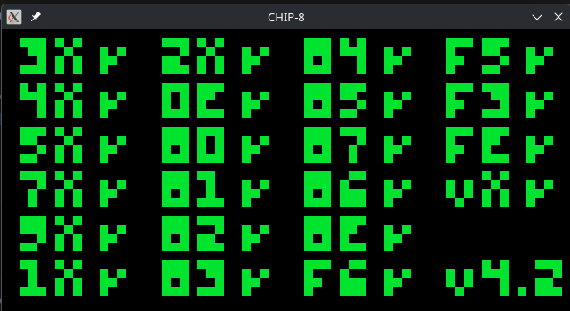
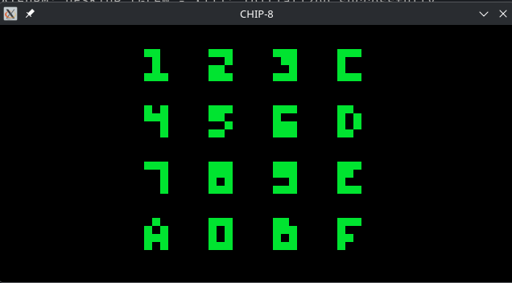

# CHIP-8 Emulator

A command-line CHIP-8 emulator written in C with [raylib](https://www.raylib.com/).
Pass a ROM path and play.


## Screenshots

| Timendus corax           | Timendus keypad       |
| ------------------------ | --------------------- |
|  |  |

## Features

- Supports all instructions of the original CHIP-8
- Keyboard input mapped to the CHIP-8 keypad
- Sound (beep) support
- Easy to use

## Why I made this

I made this cause i was Intserted in emulators. My frined also suggested this to start with.

## How it works

- **Memory and registers:** 4 KB of memory, sixteen 8-bit registers (Vx0–VxF),
  an index register `I`, a program counter and a 16-level stack, all in one
  `Chip8` struct in `chip8.h`.
- **Mian loop:** each cycle reads a 2-byte opcode from memory,
  advances the program counter, then decodes it by masking out the nibbles
  and runs the insturctions.
- **Display:** a 64×32 display. Sprites are XORed (D instruction) into it, and
  `VF` register is set when a pixel gets collision.
- **Reference:** built from Cowgod's CHIP-8 Technical Reference.

## Requirements

raylib is reqiured. Install it with your package manager

Fedora:

```
sudo dnf install gcc cmake git raylib-devel
```

Debian/Ubuntu:

```
sudo apt install build-essential cmake git libraylib-dev
```

Arch:

```
sudo pacman -S base-devel cmake git raylib
```

Linux only.

## Quick check (for prebuilt binary)

The prebuilt binary is built on raylib 5.5, so it needs raylib 5.5
installed (see Requirements). If you get a `libraylib.so` error, your raylib
version is different, so build from source instead.

Download `chip8` from the
[latest release](https://github.com/shantanuparte/chip8/releases/latest),
and `beep.wav` and `Airplane.ch8` from this repo. Put all three in the
same folder, then run

```
chmod +x chip8
./chip8 Airplane.ch8
```

use S in the airplane game

You can run other `.ch8` file the same way.

## Build from source

```
git clone https://github.com/shantanuparte/chip8.git
cd chip8
cmake -S . -B build
cmake --build build
./build/chip8 Airplane.ch8
```

If CMake fails, compile directly

```
cd src
gcc *.c -o chip8 -lraylib -lGL -lm -lpthread -ldl -lrt -lX11
./chip8 ../Airplane.ch8
```

## Controls

| CHIP-8  | Keyboard |
| ------- | -------- |
| 1 2 3 C | 1 2 3 4  |
| 4 5 6 D | Q W E R  |
| 7 8 9 E | A S D F  |
| A 0 B F | Z X C V  |

## Project structure

| File               | What it does              |
| ------------------ | ------------------------- |
| `src/main.c`       | Main loop for the program |
| `src/chip8.c / .h` | instructions of chip8     |
| `src/draw.c / .h`  | window and keyboard input |

## Troubleshooting

- **`libraylib.so.550: cannot open shared object file`:** install raylib 5.5 or build from source.

## License

MIT License
